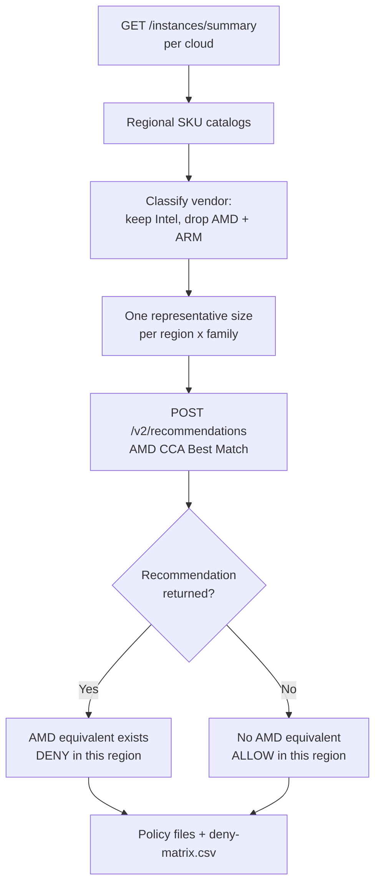

# AMD IAM Policies

Governance policies for **AWS, Azure, GCP, and OCI** that block new **Intel** instance launches — but only in the places where an **AMD EPYC equivalent actually exists**.

The hard part of a policy like this isn't the syntax. It's knowing where you're allowed to say no. Deny too broadly and you break the storage, GPU and HPC workloads that have no AMD option, or you strand a team in a region AMD hasn't reached yet. These policies answer that question from **AMD CCA (EPYC Advisory)** — the same engine behind the Cloud Cost Assessment — rather than from SKU name patterns.

Each cloud has its own folder with the policy files and a detailed README. This page is the overview; pick your cloud below.

## Pick your cloud

| Cloud | Folder | Mechanism | Applies at |
|-------|--------|-----------|------------|
| **AWS** | [`aws/`](aws/) | Service Control Policy (+ Declarative Policy for Auto Scaling) | Root, OU, or account |
| **Azure** | [`azure/`](azure/) | Azure Policy definition, `effect` parameterized | Management group, subscription, or resource group |
| **GCP** | [`gcp/`](gcp/) | Custom Organization Policy constraints | Organization, folder, or project |
| **OCI** | [`oci/`](oci/) | IAM policy (allow-list) + compartment quotas | Tenancy or compartment |

> Each folder's README covers what the policy guarantees, how the list was derived, how to apply it at each scope, and — importantly — what it does **not** do.

## The rule

One rule, applied per region and per instance family:

```
AMD equivalent exists in this region  ->  DENY new Intel launches of that family
No AMD equivalent in this region      ->  ALLOW Intel, unchanged
```

That single rule is what produces the two carve-outs:

- **Families with no AMD counterpart stay allowed.** Storage-dense, GPU, HPC and accelerated families aren't in CCA's catalog at all, so no policy here names them. On Azure, the brand-new `_v7` Intel families (D/E v7) return no recommendation and are explicitly left alone.
- **Regions without AMD stay open.** Eleven AWS regions and one GCP region came back with zero denials — Intel is fully permitted there, by the data, not by an exception list someone maintains by hand.

**ARM is out of scope.** Graviton, Cobalt, Axion and Ampere are never denied. On OCI — where enforcement has to be inverted into an allow-list — the Ampere shapes are listed explicitly so that omission can't deny them by accident.

**Nothing running is touched.** Every policy is a create-time guard. No sweep, no termination, no reclaim.

## How the equivalence was determined



**What we take in** — each cloud's live regional instance catalog from `GET /instances/summary?provider=`.

**How we transform it** — every SKU is classified by silicon vendor. AMD and ARM families are dropped; only Intel is probed. Families are probed once at a representative large size, because **size doesn't change the answer** — this was checked directly: all eight `af-south-1` c5 sizes return nothing, all eight `us-east-1` m5 sizes return a recommendation, and `standard_d{2..64}s_v5` all map to the same AMD series. Edge sizes agree too (`t3.nano` → `t3a.nano`, `c7i.metal-48xl` → `c8a.metal-48xl`).

**What comes out** — a deny/allow verdict per region × family, turned into native policy files plus a `deny-matrix.csv` in every cloud folder showing exactly which probe produced which verdict.

## What the sweep found

4,112 probes, run 2026-10-21:

| Cloud | Regions | Intel families | Probes | Deny (region × family) | Allow (carve-outs) |
|-------|---------|----------------|--------|------------------------|--------------------|
| **AWS** | 33 | 24 | 489 | 291 across 22 regions | 198 |
| **Azure** | 53 | 61 | 2,630 | 2,132 across 53 regions | 498 |
| **GCP** | 43 | 22 | 908 | 655 across 42 regions | 253 |
| **OCI** | 45 | 4 | 85 | 85 across 43 regions | 0 |

Full per-family breakdown: [gap-analysis-2026-10-21.md](gap-analysis-2026-10-21.md).

**Every recommendation was cross-checked against the catalog of the region it was issued for.** Zero recommendations pointed at a family that region doesn't offer — so no deny rule can leave a workload with nowhere legal to go. The generator re-runs this check and refuses to emit policies if it ever fails.

### Why not just match names?

Because name-matching is wrong often enough to break things. `af-south-1` lists `c5a`, so "c5 → c5a" would deny seven families there — but CCA returns no recommendation for any c5 size in that region, so the correct answer is **zero denials**. In `ap-northeast-2`, name-matching gives 28 denials; CCA gives **two** (`t2`, `t3`). This gap is the entire reason the policies are generated rather than written.

## Regenerating

```bash
pip install -r requirements.txt
python generate.py --key-file /path/to/cca_api_key.txt
```

Re-derives every policy file, every `deny-matrix.csv`, the dated gap analysis and the JSON snapshot from the live CCA API. Takes about a minute. The token is read into memory and is **never printed, logged, or written into any output file** — `generate.py` carries no embedded credential and `data/cca-snapshot-*.json` contains only catalog and verdict data.

Get an API key from the EPYC Advisory Portal: Profile → Generate API Key. AMD employees log in directly.

Pass `--snapshot data/cca-snapshot-2026-10-21.json` to rebuild the policies from the committed snapshot without calling the API at all.

### On a schedule

These policies have a shelf life. AMD adds regions and instance families several times a year, and each time it does, some region × family pair that *had* no AMD equivalent now has one — and the committed policy quietly stops enforcing what it claims to enforce.

[`automation/`](automation/) runs this same script weekly in whichever cloud you already operate, and notifies you **only when the answer actually changes** (roughly 2 runs in 52). It's optional — the policy pack above is complete without it.

| Cloud | Native template | Terraform | Compute |
|-------|-----------------|-----------|---------|
| [AWS](automation/aws/README.md) | CloudFormation | yes | Lambda |
| [Azure](automation/azure/README.md) | Bicep | yes | Container Apps Job |
| [GCP](automation/gcp/README.md) | — *(Terraform is native)* | yes | Cloud Run Job |
| [OCI](automation/oci/README.md) | — *(Terraform is native)* | yes | Functions |

You only need one — the sweep covers all four clouds' catalogs wherever it runs. GCP and OCI have no second format because they no longer have one: Deployment Manager shut down 2026-03-31 and Infrastructure Manager runs Terraform, and OCI Resource Manager has always been Terraform.

It regenerates artifacts into object storage and nothing more. **Promoting a regenerated policy stays a human review step** — the change alert exists to tell you a review is due, not to widen a Deny policy across your organisation unattended.

## Rolling this out

Start in audit mode. Every cloud supports it and every folder README shows how:

| Cloud | Dry-run mechanism |
|-------|-------------------|
| AWS | `aws ec2 run-instances --dry-run`, plus the deny-matrix to predict the outcome |
| Azure | `effect: Audit` (the shipped default) and `enforcementMode: DoNotEnforce` |
| GCP | `gcloud org-policies set-policy --dry-run` |
| OCI | Apply the IAM policy to a test group in a non-production compartment first |

Read the compliance report, confirm the blast radius matches the deny-matrix, then flip to enforcing.

## Files

```
amd-iam-policies/
  generate.py                     re-derives everything from the live CCA API
  requirements.txt
  gap-analysis-2026-10-21.md      per-cloud, per-family deny/allow report
  data/cca-snapshot-2026-10-21.json   catalogs + per-probe verdicts (no credentials)
  aws/    SCP x2, Declarative Policy + notes, deny-matrix.csv, README
  azure/  policy definition, assignment + exemption examples, deny-matrix.csv, README
  gcp/    custom constraints x2, org policy example, deny-matrix.csv, README
  oci/    IAM allow-list, quota policy, deny-matrix.csv, README
  automation/                     optional: run the above weekly
    runner.py                     headless wrapper - 4 secret stores, 4 object stores
    validate.py                   static checks on every template
    Dockerfile, package.sh        images for Azure/GCP; zip for Lambda
    aws/    cloudformation.yaml + terraform/, README
    azure/  main.bicep + vault-access.bicep + terraform/, README
    gcp/    terraform/, README
    oci/    terraform/ + its own Dockerfile/func.py (Fn contract), README
```
